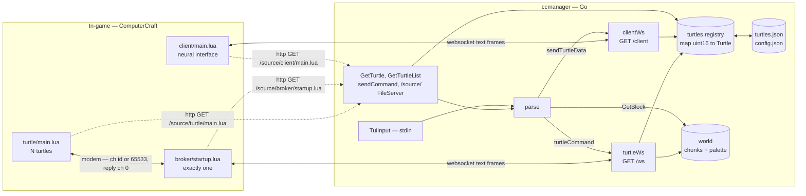
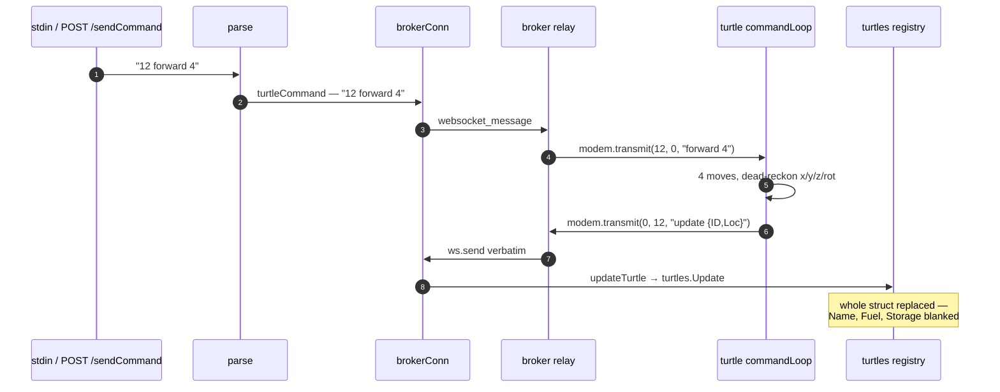

# Architecture map

A mechanical map of what exists right now: the file tree, every function in
every file, and roughly what each one calls. Companion to [README.md](README.md)
(goal, constraints, versions) and [DESIGN.md](DESIGN.md) (rationale, most of it
still ahead of the code).

This file describes the code as written, not as intended. Where the two
disagree, that's noted rather than smoothed over.

---

## Contents

1. [Directory tree](#1-directory-tree)
2. [The shape of the system](#2-the-shape-of-the-system)
3. [Go: file by file](#3-go-file-by-file)
4. [Lua: file by file](#4-lua-file-by-file)
5. [Wire protocol, in one place](#5-wire-protocol-in-one-place)
6. [Data flow walkthroughs](#6-data-flow-walkthroughs)
7. [Loose ends found while mapping](#7-loose-ends-found-while-mapping)
8. [Tooling for graphing this](#8-tooling-for-graphing-this)

---

## 1. Directory tree

```
ccmanager/
├── cmd/
│   └── server/
│       └── main.go              entry point; setup, three goroutines, signal wait
├── internal/
│   ├── server/                  transport shell: http, websockets, auth, CLI
│   │   ├── init.go              config form, config.json load/save, port validation
│   │   ├── init_test.go         table test for validatePort
│   │   ├── http.go              routes, auth middleware, turtle json handlers
│   │   ├── turtle.go            /ws  — the broker socket (fleet side)
│   │   ├── client.go            /client — the neural-interface socket (viewer side)
│   │   └── commandparser.go     stdin/HTTP command parsing, outbound to broker
│   ├── turtles/                 domain: the registry and its persistence
│   │   ├── data.go              Turtle, Item, Loc, Rot types + registry map
│   │   ├── operations.go        Register / Update / Get / GetAllIDs / GetAllData
│   │   ├── operations_test.go   table test for Register
│   │   ├── saves.go             SaveData / LoadData / PeriodicSave
│   │   ├── scan.go              ProcessScan — stub, currently unreferenced
│   │   └── controls.go          entirely commented out (a goTo sketch)
│   ├── world/                   voxel world model
│   │   ├── scan.go              ScanMsg, Scan pipeline, chunk keying, palette
│   │   └── functions.go         GetBlock
│   └── utils/
│       ├── vector.go            Vector32/16/8, UVector8, Int32VectorAdd
│       └── helpers.go           ToInteger
├── lua/                         served verbatim over HTTP at /source/
│   ├── broker/
│   │   └── startup.lua          the single relay: websocket <-> modem
│   ├── turtle/
│   │   ├── startup.lua          bootstrap: self-install, fetch main.lua, run, reboot
│   │   └── main.lua             the agent: command loop + ping loop
│   ├── client/
│   │   ├── startup.lua          bootstrap: fetch main.lua, cache locally, run
│   │   ├── main.lua             AR overlay + HUD over the neural interface
│   │   └── gpsprobe.lua         one-off diagnostic, not part of the system
│   ├── NOTES.md
│   └── PLETHORA.md
├── README.md
├── DESIGN.md
├── README_incomplete.md
├── go.mod / go.sum
├── config.json                  ← gitignored, written by Setup
├── build/                       ← gitignored; the actual runtime cwd
│   ├── ccmanager.exe
│   ├── config.json
│   └── turtles.json
├── .idea/                       ← IntelliJ project; note .idea/httpRequests/
└── .vscode/
```

**One correction to README's Layout section:** it says `parts/server`, which is
`cmd/server`, and it predates `internal/world`, `lua/broker`, and `lua/client`.

**The `build/` directory is load-bearing.** `Start` serves the Lua sources from
`http.Dir("../lua")` — a path relative to the working directory. The binary has
to run from `build/` for turtles to be able to fetch their own code, and
`config.json` / `turtles.json` are read and written relative to cwd too.

**Import direction** (no cycles, and `internal/` enforces the boundary):

```
cmd/server  →  server  →  turtles
                      →  world  →  utils
                      →  utils
```

`turtles` imports nothing internal. `world` imports only `utils`. Everything
transport-shaped is confined to `server`, which is the rule README states.

---

## 2. The shape of the system

Five processes, three of them in-game:



Two things about this shape drive everything else:

**Turtles never speak to the server.** They speak modem to the broker; the
broker holds the only fleet websocket and relays frames in both directions
mostly verbatim. So `brokerConn` is a single global socket, and if it's `nil`
no command can be delivered — `parse` checks for exactly that.

**The client is a separate socket with a separate vocabulary.** `clientConn`
and `brokerConn` are independent package-level globals in `http.go`, each set
by its handler and nil'd on disconnect. Neither is guarded by a mutex.

**The interesting edges are not function calls.** Half the data flow crosses a
websocket or a modem transmission, which no static analyser will follow. That's
the single most important fact for §8.

---

## 3. Go: file by file

Notation: `→` means "calls". Standard library and logging calls are omitted
unless they carry meaning.

### `cmd/server/main.go`

- **`main()`** — the whole lifecycle.
  → `server.Setup()` → `turtles.LoadData(turtleDataPath)` → `go server.Start(port)`
  → `go server.TuiInput()` → `go turtles.PeriodicSave(path)` → blocks on
  `os.Interrupt` → `turtles.SaveData(path)`.
  `turtleDataPath` is the bare string `"turtles.json"`, so cwd-relative.

### `internal/server/init.go`

Package-level `var port uint16` — written as a *side effect* of `validatePort`
and read back by `OpenForm`.

- **`Setup() (uint16, error)`** — the only exported entry.
  → `needsForm(path)`; if true → `OpenForm()` → `RegisterPassword()` → `saveConfig()`.
  If false → `loadConfig()` → `setHash()` and returns early.
- **`OpenForm() (uint16, string, error)`** — huh form for port + password.
  → `validatePort` (as the input's `Validate` closure). Returns the package
  `port`, not a local.
- **`needsForm(path) bool`** — true if the config file can't be read, or
  `os.Args[1] == "-c"`.
- **`loadConfig(path) (uint16, []byte)`** — reads and unmarshals an anonymous
  `{port, hash}` struct. `log.Fatal`s if port is zero.
- **`saveConfig(port, hash, path) error`** — marshals the same anonymous struct,
  writes 0600.
- **`validatePort(input) error`** → `strconv.Atoi`; range 1–65535; assigns the
  package `port` on success. This is what `init_test.go` exercises.

### `internal/server/http.go`

Package state: `hash []byte`, `upgrader websocket.Upgrader`,
`brokerConn *websocket.Conn`, `clientConn *websocket.Conn`.

- **`Start(port) error`** — the routing table. Every route is wrapped in `check`:

  | route | method | handler |
  |---|---|---|
  | `/source/` | GET | `http.FileServer(http.Dir("../lua"))`, prefix-stripped |
  | `/getTurtle` | GET | `GetTurtle` |
  | `/getAll` | GET | `GetTurtleList` |
  | `/ws` | GET | `turtleWs` |
  | `/client` | GET | `clientWs` |
  | `/sendCommand` | POST | `sendCommand` |

  → `http.ListenAndServe`.
- **`check(method, next) http.HandlerFunc`** — the auth middleware. Rejects on
  method mismatch (405), then `bcrypt.CompareHashAndPassword(hash, Authorization header)`
  (401), then → `next`. Every route goes through it, including the source
  fileserver, which is how the Lua bootstraps authenticate.
- **`setHash(h)`** ← `Setup`.
- **`RegisterPassword(password) ([]byte, error)`** → `bcrypt.GenerateFromPassword`
  at `bcrypt.MinCost`. ← `Setup`.
- **`RegisterTurtle(b []byte)`** ← `turtleWs` case `"register"`.
  → `json.Unmarshal` into `turtles.Turtle` → `turtles.Register(data.ID, data.Name)`
  → `turtles.SaveData("turtles.json")`.
- **`updateTurtle(b []byte)`** ← `turtleWs` case `"update"`.
  → `json.Unmarshal` → `turtles.Update(data.ID, data)`. Silent on every error.
- **`GetTurtle(w, r)`** ← HTTP. → decodes `{"ID": n}` **from a GET body**
  → `turtles.Get(id)` → encodes the `*Turtle`.
- **`GetTurtleList(w, _)`** ← HTTP. → `turtles.GetAllIDs()`, printed with `%v`
  (Go slice formatting, `[1 2 3]`, not JSON).
- **`sendCommand(w, r)`** ← HTTP POST. → `io.ReadAll` → `parse(string)` → 204.
  Nothing in `lua/` calls this; it's the door for an external UI.

### `internal/server/turtle.go` — the broker socket

- **`turtleWs(w, r)`** ← route `/ws`. → `upgrader.Upgrade`, assigns `brokerConn`,
  `defer` nils it and closes. Then loops on `conn.ReadMessage`, splits the first
  space-delimited word as a verb, and dispatches:

  | verb | → |
  |---|---|
  | `update` | `updateTurtle(rest)` |
  | `register` | `RegisterTurtle(rest)` |
  | `getIDs` | `turtles.GetAllIDs()`, replies `list [ids]` |
  | `scan` | `parseScan(rest)` |
  | `heartbeat` | `writeStatus(rest)` |

  Anything else is logged and dropped.
- **`writeStatus(b)`** → `strings.Fields` → `strconv.Atoi` per id →
  `turtles.WriteStatus(id)`.
- **`parseScan(b)`** → `json.Unmarshal` into `world.ScanMsg` → rejects
  `Rot == -1` → `world.Scan(scan)`.

### `internal/server/client.go` — the viewer socket

- **`clientWs(w, r)`** ← route `/client`. Same upgrade/assign/defer shape as
  `turtleWs`, but sets `clientConn`. Dispatches:

  | verb | → |
  |---|---|
  | `getIDs` | replies `list [ids]` |
  | `getBlocks` | **empty case — no body** |
  | `getTurtles` | `sendTurtleData()` |

- **`sendTurtleData()`** ← `clientWs`, and ← `parse` (at the end of every
  non-numeric command). → `turtles.GetAllData()` → `json.Marshal` →
  `clientConn.WriteMessage("turtles " + json)`.
  Called from `parse` without checking `clientConn != nil`.

### `internal/server/commandparser.go`

- **`TuiInput()`** ← `main` goroutine. `bufio.Scanner` over stdin → `parse` per line.
- **`parse(s)`** ← `TuiInput` and ← `sendCommand`. Splits on whitespace. If the
  first field parses as a `uint16`, it's a turtle id → requires `brokerConn != nil`
  → `turtleCommand(id, rest)` and returns. Otherwise:

  | command | → |
  |---|---|
  | `-1` | `turtleCommand(65533, args)` — the broadcast channel |
  | `getblock x y z` | `utils.ToInteger` ×3 → `world.GetBlock(Vector32)` → logs the name |
  | `list` | `turtles.GetAllIDs()` |
  | `commands` | TODO, empty |
  | `update` | `turtleCommand(65533, ["reboot"])` then `turtleCommand(0, ["reboot"])` |
  | `clear` | ANSI clear |
  | *default* | logs "unknown command" |

  Then, for every non-numeric branch including the errors, → `sendTurtleData()`.
- **`turtleCommand(id, args) string`** → `brokerConn.WriteMessage("<id> <args...>")`.
  Returns the error string or `""`; nothing reads the return.

### `internal/turtles/data.go`

Unexported `var turtles = make(map[uint16]*Turtle)` — the registry itself.

Types: **`Turtle`** {ID, Name, Loc, Fuel, Storage [16]Item, Status},
**`Item`** {Id, Name, Count, Slot}, **`Loc`** {X, Y, Z, Rot},
**`Rot`** (uint8 enum: North/East/South/West).

- **`(Rot) String() string`** — the only method. `Loc` embeds `Rot`, so `Loc`
  inherits it.

JSON tags exist on `Turtle` (lowercase) but **not** on `Loc`, `Item`, or the
embedded `Rot`. Decoding survives on `encoding/json`'s case-insensitive
fallback, which is what lets the Lua side send `ID`/`Loc`/`X`. The client's
`pick()` helper exists because of exactly this asymmetry.

### `internal/turtles/operations.go`

- **`Register(id, name) error`** — rejects duplicates (`ErrAlreadyRegistered`),
  empty or >50-char names (`ErrInvalidName`), id 0 (`ErrInvalidID`). Stores
  `&Turtle{ID, Name}`.
- **`Update(id, t) error`** — `ErrInvalidID` if absent, else `turtles[id] = &t`.
  **Replaces the whole struct.**
- **`Get(id) *Turtle`** — bare map read, nil for unknown ids.
- **`GetAllIDs() []uint16`** — map iteration, so unordered.
- **`GetAllData() []Turtle`** — dereferences every pointer into a value slice.
- **`WriteStatus(id)`** — `turtles[id].Status = true`. Unchecked.

### `internal/turtles/saves.go`

- **`SaveData(path) error`** → `json.MarshalIndent` a `[]Turtle` → `os.WriteFile` 0600.
  ← `main` (on shutdown), `PeriodicSave`, `RegisterTurtle`.
- **`LoadData(path)`** → `os.ReadFile` → `json.Unmarshal` → repopulates the map.
  All errors ignored, so a missing file is a clean empty start.
- **`PeriodicSave(path)`** → `time.Sleep(5m)` → `SaveData`. **Not a loop.**

### `internal/turtles/scan.go` / `controls.go`

`ProcessScan(raw, id)` logs the turtle's position and the raw string. Nothing
calls it — scans go through `world.Scan` instead. `controls.go` is a fully
commented-out `goTo` sketch.

### `internal/world/scan.go`

Package state: `worldPalette []string`, `chunks map[uint64]map[utils.UVector8]uint16`.

**`ScanMsg`** {ID, Radius, Rot int8, Pos [3]int32, Palette []string, Blocks [][4]int8}
— tags are all lowercase and match what `turtle/main.lua` emits exactly.

- **`Scan(msg)`** ← `parseScan`. → `makePalette(msg)`, then per block →
  `convert(b, msg.Pos, msg.Rot, dict)` → `setBlock(idMap, coords)`. Then logs
  the entire world palette, every scan.
- **`makePalette(msg) []uint16`** → `existsInPalette` per entry; appends new
  names to `worldPalette`; returns a local→global index map.
- **`existsInPalette(block) (bool, uint16)`** — linear scan. On miss returns
  `len(worldPalette)`, i.e. the index the block is *about to* occupy.
- **`convert(b, p, r, d) ([3]int32, uint16)`** → `transform(b, p, r)`, and
  `d[b[3]]` for the palette remap.
- **`transform(b, t, r)`** → `rotate(b, r)` → `translate(_, t)`.
- **`rotate(b, rotation) [3]int8`** — 90° increments; `default` falls back to
  the `case 0` mapping.
- **`translate(b, t) [3]int32`** → `utils.Int32VectorAdd`.
- **`setBlock(blockType, pos)`** → `getKey` → lazily creates the chunk map →
  `inChunkPos` → writes.
- **`getKey(pos) uint64`** — packs `x>>4` (22 bits) `<<34 | y>>4` (12) `<<22 | z>>4` (22).
- **`inChunkPos(worldPos) UVector8`** — `& 15` on each axis. Correct for
  negatives under two's complement.

### `internal/world/functions.go`

- **`GetBlock(position) (string, error)`** ← `parse` case `getblock`.
  → `getKey` → `inChunkPos` → indexes `worldPalette`. Distinct errors for
  "chunk doesn't exist" and "block doesn't exist".

### `internal/utils`

- **`ToInteger(string) int32`** → `strconv.Atoi`, error discarded (bad input
  becomes 0).
- **`Int32VectorAdd(a, b [3]int32) [3]int32`**.
- `Vector32` / `Vector16` / `Vector8` / `UVector8` — plain X,Y,Z structs.

---

## 4. Lua: file by file

All five runtime scripts are top-level programs, not modules — nothing
`require`s anything. Functions are `local` and the file ends by handing a set of
them to `parallel.waitForAny`.

### `lua/broker/startup.lua` — the relay

Config at the top: `host`, `password`, `brokerChannel = 0`, `allChannel = 65533`,
`heartbeat = 0.5s`, `staleAfter = 500ms`, backoff constants.

Runs a self-update before anything else: GET `/source/broker/startup.lua`, and
if the body differs from the local file and `load()`s clean, write it and
`return new()` — tail-calling the fresh copy, which then finds itself identical
and falls through.

State: `ws`, `status`, `phase`, `known` (id→true), `lastSeen` (id→epoch ms).

- **`isUp(tid)`** — `lastSeen[tid]` within `staleAfter`. Deliberately independent
  of the server link.
- **`draw()`** → `isUp`; paints server status, phase, and one line per known id
  to the monitor. Has a nested `line()` helper.
- **`chime(up)`** — two speaker notes, ascending for up.
- **`delay(attempt)`** — 0.5s ×20, 1s through 80, then `1.3^n` capped at 30s.
- **`connect()`** → `draw`, `http.websocket` (3s timeout), `delay`; loops until
  a socket exists. Sleeps in 1s steps so `phase` can count down.
- **`relay()`** → `os.pullEvent` forever.
  `websocket_closed` → return (caller reconnects).
  `modem_message` → forward upstream via `ws.send` **unless** it matches
  `^pong %d+$`.
  `websocket_message` → tokenise; if word 1 is `0` handle locally (`reboot` →
  `os.reboot`); if word 1 is any other number → `modem.transmit(id, 0, rest)`;
  if word 1 is `list` → scrape `%d+` into `known` → `draw`; else print.
- **`connectionLoop()`** → `connect` → `chime(true)` → `ws.send("broker <id> online")`
  → `ws.send("getIDs")` → `relay()` → close, `chime(false)`, `draw`, repeat.
- **`pingLoop()`** → `modem.transmit(65533, 0, "ping")` every 0.5s; then builds
  the up-list via `isUp` and `ws.send("heartbeat <ids>")`; → `draw`.
- **`pongLoop()`** → `os.pullEvent("modem_message")`, matches `^pong (%d+)$`,
  sets `known` + `lastSeen`, → `draw`.

`parallel.waitForAny(connectionLoop, pingLoop, pongLoop)`.

### `lua/turtle/startup.lua` — bootstrap

No functions. Copies `disk/startup.lua` to local if present (self-install off a
floppy), GETs `/source/turtle/main.lua`, `load`s it, `pcall`s it. On any exit:
prints and `os.reboot()` after 5s — so a fix pushed to the server heals a crash
loop by itself. `Terminated` is special-cased so Ctrl+T can break in.

### `lua/turtle/main.lua` — the agent

Config: `brokerChannel = 0`, `allChannel = 65533`, `maxRepeat = 16`,
`maxRadius = 16`, `moves` table (verb → `turtle.*` function), `turns`,
`heading` (facing → unit xz step).

State: `id`, `name`, `rot = -1` (unknown until a forward/back resolves it),
`x, y, z` from `gps.locate()` at boot. Opens channels `id` and `65533`, and
transmits `register` + `update` immediately.

- **`facingFrom(dx, dz, reversed)`** — derives facing 0–3 from a position delta.
- **`state()`** → `textutils.serialiseJSON{ID, Loc{X,Y,Z,Rot}}`.
- **`pingLoop()`** → on `"ping"`, `modem.transmit(replyChannel, id, "pong <id>")`.
  Separate coroutine so it answers mid-command.
- **`commandLoop()`** — the dispatch:

  | cmd | behaviour |
  |---|---|
  | `forward`/`back`/`up`/`down`/`left`/`right` [n] | clamps n to 1–16; per step calls the `turtle.*` fn, updates dead reckoning; on failure transmits `<id> <cmd> <completed> <reason>` and breaks; always ends with `update <state()>` |
  | `getrot` | `update <state()>` |
  | `gps` | `gps.locate` → `update <state()>`, or `<id> gps 0 no fix` |
  | `ping` | no-op here (handled by `pingLoop`) |
  | `refuel` [n] | `turtle.refuel` → `refuel {ID, OK, Fuel, Reason}` |
  | `scan` [r] | `scanner.scan("block", r)`, interns names into a palette, emits `scan {id, radius, pos, rot, palette, blocks}` |
  | `reboot` | acks then `os.reboot()` |

  → `facingFrom`, `state`. The first `forward`/`back` while `rot < 0` does a
  two-position GPS fix to resolve facing and position together.

`parallel.waitForAny(commandLoop, pingLoop)`.

### `lua/client/startup.lua` — bootstrap

No functions. GETs `/source/client/main.lua`; if it compiles, caches it to
`main.lua`. **Always runs the local copy** via `shell.run`, so the glasses work
with the server down.

### `lua/client/main.lua` — AR overlay

Requires `neuralInterface`. `canvas3d` for world geometry, `canvas` for the flat
HUD; either may be absent.

State: `ws`, `meta`, `origin`, `chunk`, `chunkData`, `turtles`, `dirty`, `root`.

- **`try(obj, name, ...)`** → `pcall` twice (with and without self) — Plethora
  builds disagree on method names and calling convention.
- **`seeThrough(obj)`** → `try(setDepthTested)` / `try(setDepthTest)`.
- **`pick(t, ...)`** — first present key of several spellings. Exists because
  the Go payload mixes `ID`/`id` and `X`/`x`.
- **`addTurtle(out, t, key)`** → `pick`. **Merges** into an existing record so a
  partial push doesn't blank name/fuel.
- **`readTurtles(payload)`** → `pick`, `addTurtle`. Accepts an array, an object
  wrapping one, or an object keyed by id.
- **`playerPos()`** → `gps.locate` + `modules.getMetaOwner().withinBlock`,
  sampled together so they describe the same tick.
- **`box(...)`** → `root.addBox` → `seeThrough`.
- **`ring(...)`** → `box` ×4 (canvas3d has no line primitive).
- **`drawChunk(px,py,pz)`** → `ring`, `box` — the 16³ cage plus optional
  floor/ceiling rings.
- **`colourFor(name)`** — deterministic hash → RGBA.
- **`drawBlocks(...)`** → `box`, `colourFor`; capped at `maxBlocks`.
- **`drawTurtles(...)`** → `box`, `root.addFrame`, `seeThrough` — cube plus
  floating name/fuel label, green if up, red if down.
- **`redraw()`** → `playerPos` → `canvas.create()` → `drawChunk` → `drawBlocks`
  → `drawTurtles` → clears the *previous* group last, so there's no blank frame.
- **`drawHud()`** → `try(setScale)`; link state plus one line per turtle.
- **`send(text)`** → `pcall(ws.send)`.
- **`handle(text)`** — verb dispatch: `chunk` → `unserialiseJSON` into
  `chunkData`; `turtles` → `readTurtles`; `update` → `addTurtle` (merge);
  `reboot` → `os.reboot`; `list` → `send("getTurtles")`.
- **`linkLoop()`** → `http.websocket` `/client` → `send("getTurtles")` →
  pumps events into `handle`; on close, wipes `turtles`/`chunkData`, retries
  every 5s.
- **`inputLoop()`** — LeftAlt → `modules.launch(yaw, pitch, 3)`; RightAlt →
  dump gps/withinBlock/exact/hud-size/turtle-count. Explicitly the one loop that
  must survive everything.
- **`metaLoop()`** → `modules.getMetaOwner()` every 0.1s.
- **`positionLoop()`** → `gps.locate` every 0.5s; only on a *chunk* change does
  it set `dirty` and (if `showBlocks`) `send("getChunk x y z")`.
- **`moving()`** — motion vector magnitude > 0.01.
- **`renderLoop()`** → `moving`; redraws on `dirty`, and sets `dirty` on the
  moving→stopped edge so the final anchor is accurate.

Loop set is built conditionally: `inputLoop`, `metaLoop`, `linkLoop` always;
`positionLoop` only with a canvas; `renderLoop` with either surface.

### `lua/client/gpsprobe.lua`

Standalone. Pings GPS channel 65534 and prints host distances to six decimals,
to answer whether modem distance carries sub-block precision. Not wired into
anything.

---

## 5. Wire protocol, in one place

Every message is a text frame: **a verb, a space, and a payload**. The Go side
splits on the first space (`bytes.IndexByte(msg, ' ')`) and switches on the
verb.

**Turtle → broker (modem, reply channel 0)**

| message | consumed by |
|---|---|
| `register {ID,Name}` | relayed → `RegisterTurtle` |
| `update {ID,Name,Loc,Fuel}` | relayed → `updateTurtle` |
| `scan {id,radius,pos,rot,palette,blocks}` | relayed → `parseScan` → `world.Scan` |
| `refuel {ID,OK,Fuel,Reason}` | relayed → **no server case** |
| `pong <id>` | **absorbed by the broker**, never relayed |
| `<id> <cmd> <n> <reason>` (failure) | relayed → **no server case** |

**Broker → server (`/ws`)**

| message | handler |
|---|---|
| anything relayed from a turtle | as above |
| `broker <id> online` | **no case** — logged and dropped |
| `getIDs` | replies `list [ids]` |
| `heartbeat <id> <id> ...` | `writeStatus` |

**Server → broker (`/ws`)**

| message | broker action |
|---|---|
| `<n> <args...>`, n ≠ 0 | `modem.transmit(n, 0, args)` |
| `0 reboot` | broker reboots itself |
| `list [ids]` | scrapes digits into `known` |

**Client ↔ server (`/client`)**

| direction | message | handler |
|---|---|---|
| C→S | `getTurtles` | `sendTurtleData` |
| C→S | `getIDs` | replies `list [ids]` |
| C→S | `getChunk x y z` | **no case** (`getBlocks` exists but is empty) |
| S→C | `turtles [json array]` | `readTurtles` |
| S→C | `list [ids]` | client replies `getTurtles` |
| S→C | `update {turtle}` | `addTurtle` merge — **never actually sent** |
| S→C | `chunk {...}` | `chunkData` — **never actually sent** |

**Channels:** `0` = broker. `<turtle id>` = that turtle. `65533` = all turtles
(`-1` in the CLI). `65534` = CC's GPS. `65535` = CC's rednet broadcast.

---

## 6. Data flow walkthroughs

### A command, end to end



The reply path has no correlation id and no ack. A failed move sends
`<id> <cmd> <completed> <reason>`, which reaches the server and matches no case
in the `turtleWs` switch, so it is logged and dropped. Position after a partial
move is recovered only from the trailing `update`.

### A scan, end to end

`scan 8` → turtle → `scanner.scan("block", 8)` returns ~4,913 entries →
one pass interns names into a local palette and flattens each block to
`{x,y,z,paletteIndex}` → `serialiseJSON` → modem → broker relays verbatim →
`parseScan` → **drops the message if `rot == -1`** → `world.Scan` →
`makePalette` merges the local palette into `worldPalette` → per block
`rotate`/`translate` into world coords → `getKey` picks the chunk →
`inChunkPos` picks the slot.

Reading it back is `getblock x y z` on the CLI → `world.GetBlock`.

### Registration and liveness

Boot: turtle transmits `register {ID,Name}` and `update {...}` before opening
its own channel. Broker relays both. `RegisterTurtle` → `turtles.Register` →
immediate `SaveData`.

Liveness is two independent tracks. The broker pings channel 65533 every 500 ms
and each turtle's `pingLoop` pongs; `lastSeen` drives the monitor and stays
accurate with the server down. Separately the broker sends the derived up-list
upstream as `heartbeat <ids>`, and `writeStatus` sets `Status = true`.

### Code distribution

Every Lua process fetches its own source over authenticated HTTP at boot. The
broker restarts into a new copy in place; the turtle reboots (and `startup.lua`
refetches); the client caches locally and runs the cache. `parse`'s `update`
command is the fleet-wide push: `reboot` to 65533 and to the broker.

---

## 7. Loose ends found while mapping

Not a review, just what fell out of tracing the edges. Roughly ordered by how
much they'd bite.

1. **`PeriodicSave` runs once.** `saves.go:28` sleeps five minutes, saves, and
   returns. It needs a `for` around the body.
2. **`WriteStatus` will panic on an unknown id.** `operations.go:57` does
   `turtles[id].Status = true` with no lookup check. The ids come from the
   broker's `known` map, which is populated by *pongs* — a turtle that answers a
   ping but was never registered server-side takes the process down. Nothing
   ever sets `Status` back to `false`, either.
3. **`Update` replaces the whole struct.** A turtle's post-move `update` carries
   only `{ID, Loc}` (that's what `state()` builds), so it blanks `Name`, `Fuel`,
   and `Storage` every time. The client's `addTurtle` merge exists to paper over
   this on the display side; the registry itself still loses the data.
4. **The client never gets pushed updates.** `updateTurtle` doesn't call
   `sendTurtleData`, so the AR overlay only refreshes when a command is typed
   into the TUI (`parse`'s trailing call) or the client asks. Turtles move
   silently on screen.
5. **`getChunk` has no server handler.** `client/main.lua:482` sends it; the
   `clientWs` switch has an empty `getBlocks` case. `showBlocks` is dead
   end-to-end, and `chunkData` is never populated.
6. **Both sockets are unsynchronised globals.** `brokerConn` and `clientConn`
   are written by their handlers and read from `parse` / `sendTurtleData` on
   other goroutines. `sendTurtleData` also dereferences `clientConn` without a
   nil check — a TUI command with no client connected is a panic.
7. **A scan before the first move is discarded.** `rot` starts at `-1` and only
   resolves on the first `forward`/`back`; `parseScan` rejects `Rot == -1`.
   Correct, but surprising — `getrot` won't fix it either.
8. **`existsInPalette` is a linear scan** rebuilt per scan message, and `Scan`
   logs the entire world palette on every call.
9. **JSON tags are half-present.** `Turtle` has them, `Loc`/`Item`/`Rot` don't;
   the whole Lua↔Go mapping rides on `encoding/json`'s case-insensitive
   fallback. Adding a correctly-cased tag to `Loc` later would silently break
   nothing — but renaming a field would.
10. **`bcrypt.MinCost`** on the password hash, and `password` is a plaintext
    literal at the top of three Lua files. Fine for a LAN game server, worth
    knowing it's deliberate.
11. **Unreachable / unused:** `turtles.ProcessScan`, all of `controls.go`,
    `POST /sendCommand` (no Lua caller), `turtleCommand`'s return value,
    `parse`'s `commands` case.

---

## 8. Tooling for graphing this

### The thing to understand first

There are two graphs in this repo and they need different tools:

- **The call graph** — `main` → `Setup` → `OpenForm` → …. Static, and tools can
  derive it automatically.
- **The message graph** — `parse` → websocket → broker → modem → turtle →
  modem → broker → websocket → `updateTurtle`. This is where the actual
  behaviour lives, and **no static analyser will ever produce it**, because
  every edge is a string on a socket. Section 5's tables and the sequence
  diagram above are hand-maintained on purpose.

So: use automated tools for the Go internals, and keep a hand-drawn diagram for
the protocol. Don't go looking for a tool that does the second one.

### In IntelliJ

**First, the licensing gotcha.** Go support is a GoLand feature. IntelliJ IDEA
*Ultimate* can install the Go plugin and gets full support; IDEA *Community*
cannot. If you're on an All Products Pack, just use GoLand — same platform,
same shortcuts.

What actually helps, in rough order of usefulness here:

| Feature | Shortcut | Notes |
|---|---|---|
| **Call Hierarchy** | `Ctrl+Alt+H` | The direct answer to "what calls this / what does this call". Toggle callers vs callees in the tool window. Works properly for Go. |
| **Find Usages** | `Alt+F7` | Faster than Call Hierarchy for one hop. |
| **Go to Declaration / Implementations** | `Ctrl+B` / `Ctrl+Alt+B` | |
| **Structure tool window** | `Alt+7` (`Ctrl+F12` popup) | Per-file function list — the §3 tables, live. |
| **Go module diagram** | right-click `go.mod` → Diagrams | Dependency graph of modules, not of your functions. |
| **HTTP Client** | `.http` scratch files | You're already using it — `.idea/httpRequests/` is full of them. Worth promoting a `requests.http` into the repo root so the `/getAll`, `/getTurtle`, `/sendCommand` calls are versioned. |

**What IntelliJ will not give you:** a rendered call-graph or architecture
*diagram* for Go. The UML diagram feature (`Ctrl+Alt+Shift+U`) is JVM-only —
Java/Kotlin classes, and to a degree databases and modules. Point it at Go and
you get nothing. This is the main gap, and the reason for the next two sections.

**Two plugins worth installing for this repo specifically:**

- **Mermaid** — ships with the Markdown plugin but may need switching on in
  *Settings → Languages & Frameworks → Markdown*. Once on, the diagrams in this
  file render in the preview pane, and the same source renders on GitHub. This
  is the best home for the protocol diagram: it's text, it diffs, it lives next
  to the code.
- **EmmyLua** (or Luanalysis, its maintained fork) — without it, IntelliJ treats
  `lua/` as plain text. With it you get go-to-definition and a structure view
  across ~1,200 lines of Lua, which is roughly half this project.

Optional: **PlantUML Integration** if you prefer PlantUML's sequence syntax to
Mermaid's, and **D2** if you end up wanting a nicer-looking architecture
diagram than Graphviz produces.

### Generating the Go call graph

These are the real answer for the automated half. All of them want
[Graphviz](https://graphviz.org/download/) installed for `dot`.

**`go-callvis`** — the standard Go call-graph visualiser. Interactive, groups by
package, focusable:

```bash
go install github.com/TrueFurby/go-callvis@latest
```

```bash
go-callvis -focus internal/server -group pkg,type ./cmd/server
```

It serves an interactive SVG on `localhost:7878`. `-focus` is essential —
unfocused output on any real program is unreadable. Add `-nostd` if stdlib
noise creeps in.

**`callgraph`** from `x/tools` — no rendering, just edges, which makes it the
better one to script:

```bash
go install golang.org/x/tools/cmd/callgraph@latest
```

```bash
callgraph -algo=static -format=digraph ./cmd/server > callgraph.txt
```

`-algo=static` is the right choice here: this codebase has no interface
dispatch worth chasing, and `static` is fast and exact. Use `-algo=rta` if you
add interfaces later. `-format=graphviz` pipes straight into `dot -Tsvg`.

**`godepgraph`** — package-level imports only, which is exactly the diagram that
enforces README's "`turtles` must never import `server`" rule:

```bash
go install github.com/kisielk/godepgraph@latest
```

```bash
godepgraph -s -novendor ./cmd/server | dot -Tsvg -o deps.svg
```

**`go mod graph`** for the dependency tree, if the Charm/gorilla/crypto set ever
needs auditing:

```bash
go mod graph | modgraphviz | dot -Tsvg -o modules.svg
```

### Drawing the protocol by hand

Mermaid, in this file, checked into git. It renders in IntelliJ's Markdown
preview, on GitHub, and in most other viewers, and it diffs like code — which
matters, because the protocol tables in §5 are the part most likely to drift.

Two diagram types cover everything here:

- `flowchart` for the process/topology picture (§2).
- `sequenceDiagram` for message ordering (§6) — this is the one that actually
  explains the system, since the whole thing is a store-and-relay pipeline.

If Mermaid's layout gets in your way on a bigger diagram, **[D2](https://d2lang.com/)**
is the upgrade: better auto-layout, real containers, still plain text, has a
JetBrains plugin and a `--watch` live preview. **Excalidraw** (also a JetBrains
plugin) is better than either for a throwaway whiteboard sketch, but it's a
binary-ish blob in git and nobody updates it.

Skip C4/Structurizr and anything ArchiMate-shaped. Five processes and twenty
message types don't need a modelling language.

### Seeing the flow at runtime

The gap none of the above closes is *what actually happened*. The cheapest fix
is already half-built: `turtleWs` and `clientWs` both log every non-heartbeat
frame. Add a direction tag (`←`/`→`) and a timestamp to those log lines and you
can grep a session into a Mermaid `sequenceDiagram` with about fifteen lines of
script — which is a far better use of an afternoon than any tracing framework
at this size.
